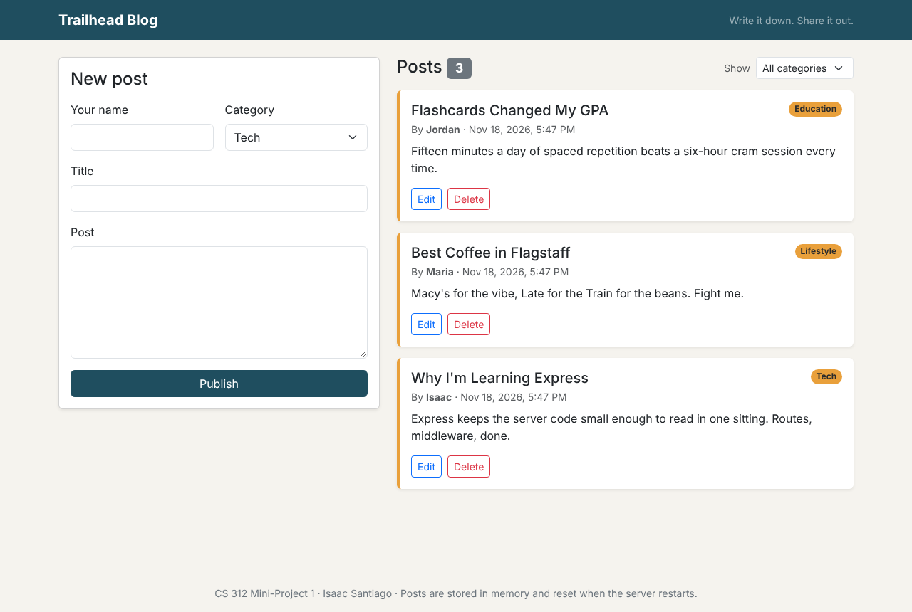
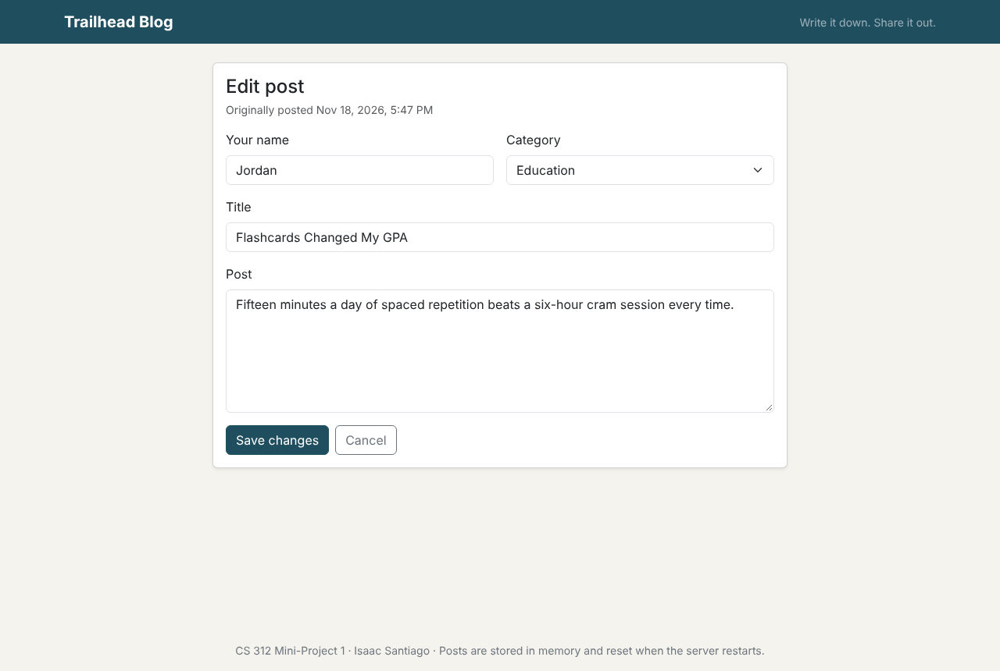
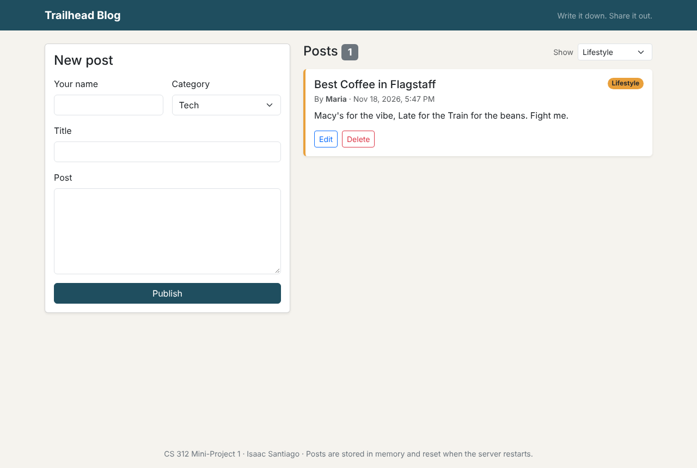
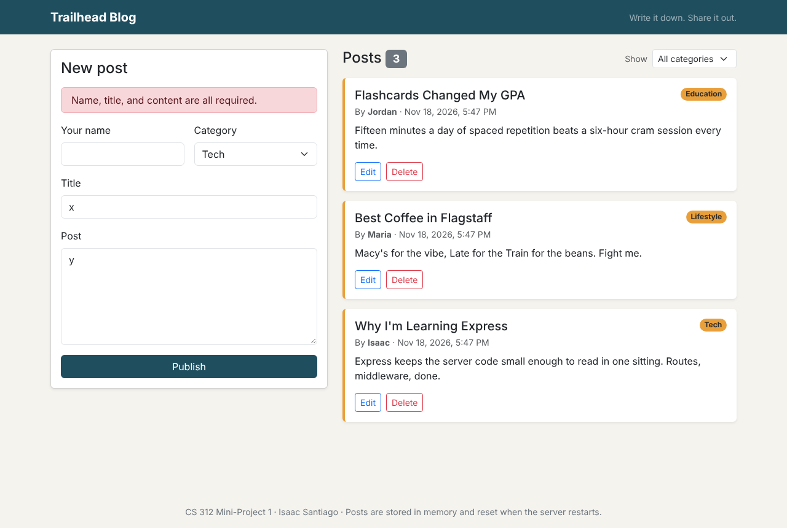
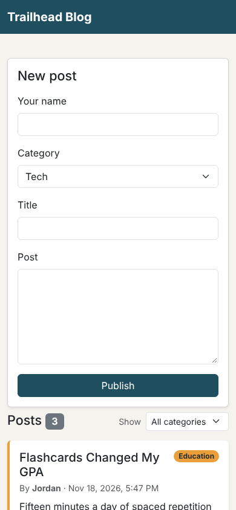

# CS-312 Mini-Project 1 (Updated): Blog Web Application

A blog built with **Node.js**, **Express.js** and **EJS**. Users can create, view, edit and delete posts, and can filter posts by category. Posts are kept in an array on the server (no database), so they reset when the server restarts.

## Features

| Requirement | How it's implemented |
|---|---|
| Create posts | Form on the home page (name, category, title, content). The creation time comes from `new Date()` on the server. |
| View posts | `index.ejs` loops over the posts array and shows the title, author, time, category and content, newest first. |
| Edit posts | `GET /posts/:id/edit` loads a form pre-filled with the post. `POST /posts/:id/edit` replaces it in the array and records an "edited" time. |
| Delete posts | `POST /posts/:id/delete` removes the post from the array, with a confirm prompt first. |
| Validation | Empty name, title or content returns the form with an error message and keeps what you typed. |
| Styling | Bootstrap 5 plus custom CSS. Two columns on desktop, stacked on mobile. |
| **Bonus: categories** | Dropdown on the create and edit forms. A filter on the home page (`/?category=Tech`) and clickable category badges. |

## Screenshots

| Home: create form + feed | Edit page |
|---|---|
|  |  |
| **Category filter (bonus)** | **Validation error** |
|  |  |
| **Mobile** | |
|  | |

## Routes

| Method | Path | Purpose |
|---|---|---|
| GET | `/` | Home page: create form and post list (optional `?category=`) |
| POST | `/posts` | Create a post |
| GET | `/posts/:id/edit` | Edit form |
| POST | `/posts/:id/edit` | Save edits |
| POST | `/posts/:id/delete` | Delete a post |

## Project structure

```
index.js              Express server, routes, in-memory storage
views/
  index.ejs           Home page (form + feed + filter)
  edit.ejs            Edit page
  404.ejs             Not-found page
  partials/           header, footer, shared post form fields
public/css/styles.css Custom styles
```

## Run it

```bash
npm install
npm start        # http://localhost:3000
```

Requires Node.js 18 or newer.
